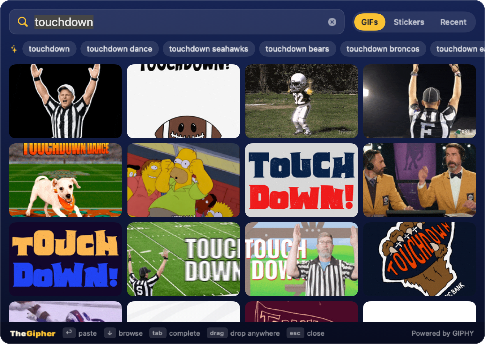

<p align="center">
  
</p>

<h1 align="center">TheGipher</h1>

<p align="center">
  All of GIPHY, one hotkey away from any conversation on your Mac.<br>
  <em>Win one for the Gipher.</em>
</p>

<p align="center">
  
</p>

Messages on the Mac only offers Apple's own small, filtered GIF search, and macOS has
no way for other apps to add themselves to the Messages "+" menu the way they can on
iOS. TheGipher is the next-fastest thing: a menu bar app with a floating search panel.
Press the hotkey while you're typing a message, search, hit Return, and the GIF lands
in the message field.

It isn't tied to Messages. It works in any app that accepts a pasted or dropped GIF
(Slack, Discord, Mail, Notes, …).

## Features

- **Global hotkey** (⌥⌘G by default) opens the panel over whatever you're doing,
  without pulling focus away from the conversation.
- **The whole GIPHY library**: GIFs and stickers, trending when you haven't typed
  anything, endless scrolling when you have.
- **One-key paste**: Return downloads the GIF and pastes it straight into the app you
  were in. Fully usable without the mouse.
- **Drag and drop**: drag any GIF out of the panel into a conversation, a document, or
  onto the desktop.
- **Suggested searches**: trending searches when the field is empty, completions of
  what you've typed otherwise. Click one, or press Tab to take the first.
- **Recent**: the GIFs you've sent, ready to send again.
- **Your choice of filtering**: content rating from G to R (R, the least filtered, is
  the default).
- **Paste size**: original quality, or smaller files for slow connections.

## Install

You need a Mac running macOS 14 or later, and Xcode (to build it).

```sh
git clone https://github.com/forcetrainer/thegipher.git && cd thegipher
./scripts/build-app.sh --install
```

That builds TheGipher, copies it to /Applications and starts it. Look for **GIF** in
the menu bar.

### First run

1. **Add a GIPHY API key.** The panel opens asking for one. Create a free key at
   <https://developers.giphy.com/dashboard/>: create an app and choose **API** (not
   SDK). Paste the key into the panel.
2. **Allow automatic pasting.** The first time you send a GIF, macOS asks you to allow
   TheGipher under System Settings › Privacy & Security › Accessibility. That
   permission is what lets it press ⌘V for you. Without it, TheGipher still copies the
   GIF and you press ⌘V yourself.

To start it automatically, turn on **Open at login** in Settings.

## Using it

| Key | Action |
| --- | --- |
| ⌥⌘G | Open or close the panel (changeable in Settings) |
| type | Search |
| ↩ | Paste the highlighted GIF, or the top result if none is highlighted |
| ↓ ↑ ← → | Move through the results |
| tab | Complete what you've typed with the first suggestion |
| ⌘1 / ⌘2 / ⌘3 | GIFs / Stickers / Recent |
| esc | Close |

With the mouse: click a GIF to paste it, drag it to drop it somewhere, or right-click
for **Copy GIF**, **Copy GIPHY Link** and **Open on GIPHY**.

Drag the panel by its top or bottom edge to move it. It reopens where you left it, so
you can park it beside your conversations.

**Settings** (menu bar **GIF** › Settings…) has the API key, content rating, paste
size, hotkey, and open-at-login.

## Good to know

- **Rate limit.** GIPHY's free key allows about 100 requests an hour. A new search
  uses two (results plus suggestions), and each further page of results uses one.
  Suggestions are remembered, so repeating a search costs less.
- **Privacy.** TheGipher talks only to GIPHY (your searches and the GIFs you load).
  Your API key and recent GIFs are stored on your Mac, in the app's preferences.
  There are no accounts and no analytics.
- **The Accessibility permission** is used for one thing: pressing ⌘V in the app you
  were typing in.

## Development

```sh
swift build                       # compile
swift test                        # unit tests
./scripts/build-app.sh            # build/TheGipher.app
./scripts/build-app.sh --install  # also copy to /Applications and relaunch
./scripts/make-icon.sh            # redraw Resources/AppIcon.icns from code
```

It's a Swift package with no dependencies:

- `Sources/GipherCore` — the GIPHY API client and models. No UI; covered by the tests.
- `Sources/TheGipher` — the app: hotkey, floating panel, search grid, paste, drag.

Debug builds can render the panel to an image without launching the app, which is how
the screenshot above was made:

```sh
BIN="$(swift build --show-bin-path)/TheGipher"
"$BIN" --snapshot live docs/screenshot.png touchdown   # real search, uses the installed app's key
"$BIN" --snapshot grid /tmp/panel.png                  # fixed content; also: empty, setup
```

The build script signs with your Apple Development certificate when you have one, so
the Accessibility permission survives rebuilds. Without one it signs ad hoc, and macOS
asks for the permission again after each rebuild.

---

GIF search is powered by [GIPHY](https://giphy.com). TheGipher is not affiliated with
GIPHY or Apple.
